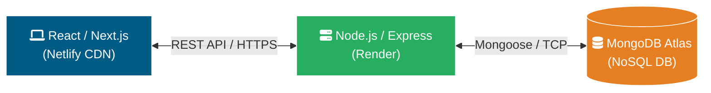

# Tienda Sol – E-Commerce Full-Stack Platform

Desarrollo end-to-end de una plataforma de comercio electrónico bajo una arquitectura monorepo, enfocada en la separación de responsabilidades, gestión ágil del estado y despliegue distribuido en la nube.


## 📑 Índice
- [El Problema y la Motivación](#problema)
- [Tech Stack y Arquitectura](#tech-stack)
- [Features Clave](#features)
- [Metodología de Versionado (GitFlow)](#versionado)
- [Aprendizajes Clave y Roadmap](#aprendizajes)
- [Visuales, Diagramas y Documentación Anexa](#visuales)
- [Instalación y Ejecución Local](#instalacion)

<a name="problema"></a>

<a name="problema"></a>
## 🧠 El Problema y la Motivación

La construcción de plataformas transaccionales de cara al usuario moderno requiere tiempos de respuesta rápidos, alta disponibilidad y un entorno de desarrollo que no ralentice las iteraciones. El desafío técnico principal fue unificar el ciclo de vida de dos aplicaciones distintas (un cliente SPA interactivo y una API RESTful) sin acoplar su infraestructura.

Se diseñó la aplicación estructurando el código base como un *monorepo*, permitiendo un desarrollo simultáneo orquestado, pero manteniendo la flexibilidad de desplegar el Frontend en una CDN global y el Backend en contenedores aislados.

<a name="tech-stack"></a>
## 🏗️ Tech Stack y Arquitectura

*    **Backend (Node.js & Express):** Provee una API RESTful stateless, encargada de la lógica de negocio, validaciones transaccionales y enrutamiento seguro de peticiones.
*    **Frontend (React & Next.js):** Capa de presentación reactiva con gestión de estado asíncrona para manejar el carrito de compras y el catálogo en tiempo real.
*    **Persistencia (MongoDB):** Base de datos NoSQL documental, elegida por su flexibilidad estructural para manejar catálogos dinámicos de productos y evolución rápida de esquemas.
*    **Infraestructura Cloud:** Despliegue productivo distribuido utilizando Netlify para la entrega de contenido estático (Edge CDN) y Render para el tiempo de ejecución del servidor Node.js.

<a name="features"></a>
## ⚡ Features Clave

*   **Arquitectura Monorepo (NPM Workspaces):** Orquestación centralizada de dependencias y linting (ESLint, Prettier) garantizando uniformidad de código entre las capas de Frontend y Backend, a la vez que se ejecutan concurridamente en desarrollo.
*   **Gestión Dinámica del E-Commerce:** Implementación completa del ciclo de vida comercial: ABM de productos, control de inventario, búsquedas filtradas y sistema de notificaciones asíncronas para el cliente.
*   **Testing Automatizado:** Cobertura de la lógica crítica de negocio utilizando Jest para pruebas unitarias y Cypress para pruebas de integración End-to-End (E2E), asegurando la estabilidad del pipeline antes de producción.
*   **Flujo de CI/CD Integrado:** Integración de repositorios mediante *GitHub Flow* con reglas estrictas de *Conventional Commits*, disparando despliegues automáticos (Webhooks) al fusionar features en la rama principal.

<a name="versionado"></a>
## 🔄 Metodología de Versionado (GitFlow)

El proyecto adopta **GitHub Flow** para asegurar un ciclo de integración y entrega continua (CI/CD) ágil. Todo desarrollo se aísla en ramas efímeras y requiere someterse a revisión mediante *Pull Requests* antes de integrarse a la rama `main`. Cada integración exitosa es empaquetada con su respectivo `tag` y *release* semántico.

Para mantener un historial de control de versiones trazable y predecible, se aplica estrictamente el estándar de **Conventional Commits**:

* **`feat:`** Introducción de nuevas características en el código (correlativo con `MINOR` en Semantic Versioning).
* **`fix:`** Corrección de bugs o parches (correlativo con `PATCH` en SemVer).
* **`BREAKING CHANGE:`** Alteraciones incompatibles en la API que exigen un cambio mayor (correlativo con `MAJOR` en SemVer).
* **Otros (`chore:`, `refactor:`, `docs:`, `build:`):** Labores de mantenimiento de infraestructura, reescritura de lógica y actualización de documentación técnica que no alteran el comportamiento público.

<div align="center">
  
</div>

<a name="aprendizajes"></a>
## 📈 Aprendizajes Clave y Roadmap

*   **CORS y Orquestación Cloud:** Desplegar servicios en dominios físicamente distintos (Render y Netlify) subrayó la importancia de asegurar estrictamente las políticas de origen cruzado (CORS) y la inyección segura de variables de entorno de producción.
*   **Escalabilidad de Estado en React:** Administrar el carrito de compras del lado del cliente me permitió optimizar el re-renderizado de componentes, centralizando el estado para evitar llamadas redundantes a la API.

<a name="visuales"></a>
## 🖼️ Visuales, Diagramas y Documentación Anexa

<div align="center">
  <h4>Arquitectura Lógica y de Despliegue</h4>
</div>



### 📄 Documentación Anexa
* [**Guía de Despliegue Cloud (deploy_doc.md)**](./deploy_doc.md): Documentación técnica (Runbook) que detalla el paso a paso de aprovisionamiento de infraestructura y configuración de variables de entorno (MongoDB Atlas, Render, Netlify) requeridas para llevar el proyecto a producción.
* [**GitFlow y Estrategia de Ramas (Diagrama)**](./resources/github_flow.png): Diagrama visual de la estrategia de versionado y *Pull Requests* utilizada por el equipo.

<a name="instalacion"></a>
## ⚙️ Instalación y Ejecución Local

Gracias a la orquestación mediante `npm workspaces` y `concurrently`, el arranque del entorno de desarrollo está completamente automatizado desde la raíz del proyecto.

```bash
# 1. Clonar el repositorio
git clone https://github.com/tsorren/Tienda-Sol-TP-DDSO.git
cd Tienda-Sol-TP-DDSO

# 2. Instalar dependencias globales y de todos los workspaces
npm install

# 3. Levantar entorno completo de desarrollo (Frontend + Backend concurrente)
npm run start:dev

# Alternativas de ejecución individual:
# Ejecutar solo Backend:  npm run dev:backend
# Ejecutar solo Frontend: npm run start:frontend
```
